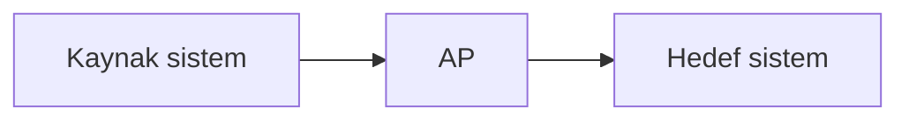

# Entegrasyon Rehberi

> Son güncelleme: 2026-11-18
> Durum: Taslak. `[TODO]` ile işaretli alanlar proje ilerledikçe doldurulacaktır.
> Kurallar için bkz. `02-developer-directives.md`.

## 1. Proje özeti

- **Proje adı:** AP [TODO: açılımı]
- **Amaç:** [TODO]
- **Kapsam:** [TODO]
- **Proje sahibi / iş birimi:** [TODO]
- **Teknik sorumlu:** [TODO]

## 2. Teknoloji yığını

| Katman | Teknoloji | Sürüm |
|---|---|---|
| Arayüz (UI) | [TODO] | [TODO] |
| Sunucu / iş mantığı | [TODO] | [TODO] |
| Veritabanı | [TODO] | [TODO] |
| Kimlik doğrulama | [TODO] | [TODO] |

## 3. Gereksinimler

- İşletim sistemi: [TODO]
- Çalışma zamanı (runtime): [TODO]
- Gerekli araçlar: [TODO]
- Erişim izinleri (ağ, veritabanı, servis hesabı): [TODO]

## 4. Kurulum

1. Depoyu klonlayın: `git clone [TODO: depo adresi]`
2. Bağımlılıkları yükleyin: `[TODO: komut]`
3. Ortam değişkenlerini tanımlayın (bkz. bölüm 6).
4. Uygulamayı çalıştırın: `[TODO: komut]`
5. Tarayıcıda açın: `[TODO: adres]`

## 5. Harici sistemler ve entegrasyonlar

| Sistem | Yön | Protokol | Kimlik doğrulama | Sıklık / tetikleyici | Notlar |
|---|---|---|---|---|---|
| [TODO: ERP / muhasebe] | Giriş / çıkış | REST / SOAP / SFTP / dosya / kuyruk | [TODO] | [TODO] | [TODO] |
| [TODO: banka / ödeme] | [TODO] | [TODO] | [TODO] | [TODO] | [TODO] |

## 6. Ortam değişkenleri

| Değişken | Zorunlu | Açıklama | Örnek değer (gerçek değer değil) |
|---|---|---|---|
| `[TODO: DEGISKEN_ADI]` | Evet / Hayır | [TODO] | `[TODO]` |

> Şifre, token ve API anahtarı bu dosyaya yazılmaz. Gerçek değerler güvenli kasada tutulur.

## 7. Veri akışı

> Yukarıdaki diyagram örnektir; `[TODO]` adımlarıyla değiştirilecektir.

## 8. Dağıtım (deployment)

- Ortamlar: geliştirme / test / üretim — [TODO]
- Dağıtım adımları: [TODO]
- Geri alma (rollback) yöntemi: [TODO]

## 9. Sorun giderme

| Belirti | Olası neden | Çözüm |
|---|---|---|
| [TODO] | [TODO] | [TODO] |
